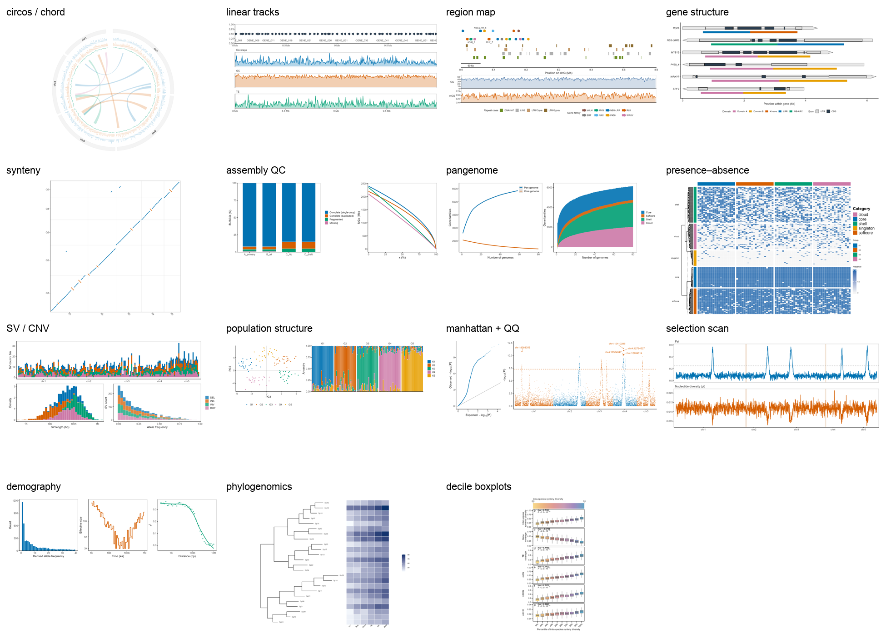

# nature-genome-plot

**将基因组、泛基因组及群体基因组的分析结果，转化为符合 Nature 系列期刊出版标准的矢量图。**


本项目包含 15 个核心图型模板、48 个期刊风格预设以及 48 张附带文献出处的风格卡片。所有模板均为可直接运行的 R 代码。
在数据高度规范时支持一键出图；对于非标准化数据，系统将先进行格式梳理与映射，再执行渲染。

> **快速概览**：导入数据 → 自动判定图型 → 诊断列名、缺失值及命名规范 → 映射为标准数据框 → 渲染两种预设风格 → 依据 12 项顶级期刊投稿标准进行合规性审查。
> 所有的生成图形与代码均遵循 MIT 许可，允许自由修改与复用。



---

## 研发初衷

基因组学文章的图形可视化通常面临三大瓶颈：

1. **图型选择不当**：例如，较少数量的染色体适合 Circos 图，但大量 contig 使用 Circos 图则会导致视觉混乱。
2. **不符合期刊美术规范**：Nature 主图严格要求 183 mm 宽度、5–7 pt 字号、纯矢量格式、字体可编辑且色盲友好。任一细节不达标均可能导致退修。
3. **数据格式难以适配**：不同测序平台或软件输出的列名缺乏统一标准（如混用 `chr1` 与 `1`，或包含 `p=0` 的极端值），加之 VCF/GFF/PAF 格式的繁琐转换，增加了脚本编写成本。

为解决上述问题，本项目将繁杂的绘图环节解构为可复用的标准化资产：图型契约、风格卡、数据适配器及合规检查清单。

---

## 工具概述

这是一个遵循 **Agent Skills** 标准的智能绘图 Skill。它既能集成于 DSH、Claude Code、Codex 等智能代理中，也可作为独立的 R 脚本库在本地环境运行。

其核心工作流包括：

1. **智能选型**：基于数据特征结构，推荐最优的可视化方案（如 Circos 或 Manhattan 图）。
2. **风格渲染**：套用内置模板，同一组数据通过切换 YAML 配置文件，即可生成 3–6 种不同风格的出版级成品图。
3. **数据格式化**：针对列名异常、染色体命名混乱、极小 p 值及 VCF/GFF/PAF 等原始格式，提供先诊断、后映射、再渲染的标准化处理。

本工具的参数知识库基于 2023–2026 年间 *Nature*、*Nature Genetics*、*Nature Plants*、*Nature Ecology & Evolution*、*Nature Microbiology* 及 *Nature Communications* 的 200 篇开放获取论文（共计 1672 张图片）构建，所有风格设定均可精确回溯至相应的 DOI 与图号。

## 适用场景

- 手头已有统计分析结果（如 PCA、GWAS、Fst、组装指标、泛基因组矩阵），亟需提升图表质量以达到顶刊标准。
- 准备向 Nature 系期刊投稿，需要确保图片尺寸、字号、配色符合编辑部硬性排版规范。
- 缺乏 R 语言（ggplot2/circlize）高级绘图经验，但需独立产出高质量可视化的研究人员。

## 不适用场景

- 寻求数据分析工具：本项目仅处理分析结果并执行渲染，不涉及 GWAS、PCA 等前置统计算法。
- 期望像素级抄袭：受限于版权，本项目仅提供“同范式重写”，不支持对特定论文原图的完全复刻。
- 绘制机制示意图/模式图：此类需求建议使用 Adobe Illustrator 等专业矢量绘图软件。

---

## 功能矩阵

| 用户需求 | 解决方案与产出 |
|---|---|
| “已有数据，但不确定适合何种图型” | 判定图型 + 提供 2 个风格对比 + 输出可运行代码 |
| “希望呈现特定论文中的视觉风格” | 匹配最接近的风格卡 + 提供同范式代码实现（非像素级复刻） |
| “已有初稿，但编辑要求调整字号与尺寸” | 执行 12 项合规性检查 + 自动修复并输出标准图 |
| “原始测序数据列名不规范” | 生成诊断报告 + 提供映射方案 + 输出清洗后的标准表格 |
| “准备投稿，需要符合特定期刊的排版尺寸” | 依据期刊硬性规格，直接输出纯矢量图 |

---

## 15 个核心图型模板

| # | 图型标识 | 解决的科学问题 | 所需数据结构 | 可选风格数 |
|---|---|---|---|---|
| 1 | `circos-landscape` | 染色体尺度的组成分布及区域间共线性关系（弦图） | 染色体长度、轨道值、区间连线表 | 6 |
| 2 | `linear-tracks` | 特定基因座位的精细图谱：基因、覆盖度、GC及重复序列 | GFF/BED + 轨道值 + 区间坐标 | 3 |
| 3 | `synteny` | 双组装基因组间的同源关系及倒位区域 | 双物种坐标对映射表 | 3 |
| 4 | `assembly-qc` | 基因组组装的完整度与连续性评估 | BUSCO 结果 + NGx 数据 | 3 |
| 5 | `pangenome-composition` | 泛基因组饱和度及核心基因组的收缩趋势 | 基因组数量、pan/core 计数统计 | 3 |
| 6 | `presence-absence` | 基因在不同基因组中的存在与缺失情况 | 基因 × 基因组 0/1 矩阵 | 3 |
| 7 | `sv-cnv` | 结构变异的类型、长度分布及频率 | SV 统计表（类型/长度/频率） | 3 |
| 8 | `population-structure` | 群体演化关系、亲缘性及基因流水平 | PCA 坐标 + ADMIXTURE 比例矩阵 | 3 |
| 9 | `manhattan-qq` | GWAS 信号的显著位点及整体系统性假阳性膨胀情况 | GWAS 汇总统计数据 | 3 |
| 10 | `selection-scan` | 全基因组受选择信号扫描（Fst 峰值 / π 谷值） | 滑动窗口统计表 | 3 |
| 11 | `demography` | 历史有效群体大小波动及重组率变化 | SFS / PSMC / LD 衰减数据 | 3 |
| 12 | `phylogenomics` | 系统发育拓扑结构及关键演化性状分布 | Newick 进化树 + 性状矩阵 | 3 |
| 13 | `binned-correlation` | 遗传多样性沿分位数与 TE/基因密度或甲基化水平的关联 | 窗口表（多样性指标 + 数值列） | 3 |
| 14 | `region-architecture` | 局部区段内基因、TE 及其他调控元件的空间排布 | 基因表 + TE 表 + 可选轨道 + 区段坐标 | 3 |
| 15 | `gene-structure` | 单一基因内的外显子、内含子及蛋白结构域架构 | 基因、外显子、结构域配置表 | 3 |

每个图型的输入契约、结构变体及硬性约束规则详见 `catalog/archetypes/<id>.yaml`。

## 48 种风格预设

内置三大风格族，确保跨图型展示时具备高度的视觉一致性：

| 风格族系 | 视觉定位 | 适用场景 |
|---|---|---|
| `minimal-editorial` | 极简白底、细线描绘、直接标注（无图例冗余） | 论文主图、开篇首图 |
| `dense-diagnostic` | 网格背景、高数据密度、信息展示优先 | 补充材料图 (SI)、全基因组扫描 |
| `high-contrast` | 加粗线条、大字号 (7–8 pt)、强对比色彩 | 组会汇报、预印本展示、PPT 投影 |

定制风格包括：
- Circos 专用：`soft-pastel`（柔和马卡龙）、`mono-blue`（单色调蓝）、`warm-editorial`（暖色编辑风）。

每张风格卡均包含 `submission_safe` 属性与色差数值（deutan/protan）；`minimal-editorial` 与 `dense-diagnostic` 已通过严格的色盲友好度测试。

---

## 部署与安装

### 系统依赖

- **R ≥ 4.4**：需安装 ggplot2、data.table、patchwork、yaml、circlize、ComplexHeatmap、ggtree、treeio、ggrepel、scales、ragg、svglite、colorspace、gggenes。
- **Python ≥ 3.9**：需安装 pandas、PyYAML、Pillow（用于目录脚本及校验）。
- **字体**：默认使用 **Arial**。若 PDF 设备不支持，将自动回落至 Helvetica。如期刊强制作图需嵌入 Arial 字体，请导出为 SVG 格式。

### 集成至 Agent

```bash
git clone [https://github.com/nongxinshengxin/nature-genome-plot.git](https://github.com/nongxinshengxin/nature-genome-plot.git)
cd nature-genome-plot

./install.sh            # 同时配置至 DSH、Claude Code、Codex（用户级）
./install.sh claude     # 仅配置指定 Agent
./install.sh project    # 部署至当前项目的 .claude/skills 或 .agents/skills
```

脚本只是建软链，不改任何配置。三个 agent 读的是同一份 `SKILL.md`（Agent Skills 标准），
区别只在目录：

| Agent | 用户级目录 | 项目级目录 | 查看/调用 |
|---|---|---|---|
| DSH | `~/.dsh/skills` | — | 重开会话 |
| Claude Code | `~/.claude/skills` | `.claude/skills` | `/skills`，或 `/nature-genome-plot` |
| Codex | `~/.agents/skills` | `.agents/skills` | `/skills`，输入 `$` 选择 |

> 旧版 Codex 也可能读 `~/.codex/skills`；若 `/skills` 里看不到，把软链再放到那里。

### 装依赖

```bash
Rscript scripts/doctor.R                # 先体检：R/包/字体/Python 一次报全
Rscript scripts/doctor.R --install      # 缺什么装什么（会先告诉你要装哪些）
Rscript scripts/install_deps.R          # 只装 R 依赖；--check 只看
pip install pandas pyyaml pillow
```

**不会装也没关系**：把报错贴给 agent，说「帮我装依赖」。skill 会跑 `doctor.R`，
用大白话说清楚缺什么、装什么、要不要管理员权限，经你同意后再装，装完重跑验证。

R 依赖分两类：

- CRAN：ggplot2、data.table、patchwork、yaml、circlize、ggrepel、scales、ragg、svglite、colorspace
- Bioconductor：ComplexHeatmap、ggtree、treeio（脚本会用 BiocManager 装）

> 模板也会自动识别项目内的 `.Rlib`（旧环境兼容用）；正常装到用户库即可。

### 验证

```bash
python3 scripts/validate/catalog_check.py     # 结构完整性
python3 scripts/validate/smoke.py             # 48 个渲染组合
Rscript scripts/validate/style_audit.R        # 色盲审计
```

---

## 快速开始

### 1. 命令行直接渲染

```bash
Rscript templates/R/population-structure.R \
  --data fixtures/population-structure \
  --style minimal-editorial \
  --out out/pop.png --width 183 --height 62 --dpi 300
```

### 2. 多风格批量生成

```bash
for s in minimal-editorial high-contrast; do
  Rscript templates/R/manhattan-qq.R --data fixtures/manhattan-qq \
    --style $s --out out/manhattan-$s.png --width 183 --height 70
done
```

### 3. Agent 交互式生成

> 输入自然语言指令（示例）：“我有一份 GWAS 汇总统计数据，计划投 Nature Genetics，请帮我生成一张主图。”

skill 会：判型 → 数据诊断 → 选取匹配风格 → 代码渲染 → 12 项规范检查 → 输出 PDF/SVG、R 代码及排版说明。

### 4. 非标准化数据清洗

```bash
python3 scripts/profile/infer_archetype.py --data messy.csv   # 猜图型
Rscript scripts/profile/profile_data.R --data messy.csv --out profile.md
Rscript scripts/profile/map_data.R --data messy.csv --map map.yaml --out clean.tsv
```

`map.yaml` 格式示例：

```yaml
rename: {CHR: chromosome, BP: position, P: p_value}
drop: [note, beta]
chr_prefix: add
drop_na: [P]
```

完整案例见 [examples/walkthrough-gwas.md](examples/walkthrough-gwas.md)。

---

## 五个工作流

| 工作流 | 触发 | 产物 |
|---|---|---|
| `new-figure` | 有数据，要出图 | 图 + 代码 + spec |
| `adapt-data` | 数据格式不规范 | 映射后的表 + 诊断 |
| `restyle` | 已有图/脚本要换风格 | 新图 + diff 说明 |
| `audit` | 只做合规检查 | 12 项报告 |
| `browse` | 不知道能画什么 | 图型清单 + 建议 |

## 数据不统一怎么办

真实数据大多不规整。按四层处理：

1. **判型**：`infer_archetype.py` 按列名和形状匹配 12 个契约，列出缺哪列
2. **诊断**：`profile_data.R` 报缺失、命名混用、p=0、重复键
3. **映射**：`map_data.R` 按 YAML 改名/加常量/丢列/增删 chr 前缀
4. **适配器**：VCF、GFF、PAF、PLINK eigenvec、bedGraph/bigWig 直接转契约表

`adapters/` 里没有的格式，给等价命令，不静默降级。

---

## 目录结构

```
├── SKILL.md                  # 路由：意图 → 工作流 → 按需加载
├── manifest.yaml             # 加载轴
├── catalog/
│   ├── index.yaml            # 15 行摘要
│   ├── archetypes/           # 输入契约、规则
│   └── styles/               # 39 张风格卡（证据 + CVD + 适用场景）
├── templates/
│   ├── R/                    # 15 个 CLI 模板
│   └── presets/              # 48 个 YAML
├── adapters/                 # 5 个格式转换
├── scripts/
│   ├── profile/              # 判型、诊断、映射
│   ├── harvest/              # 文献语料构建
│   └── validate/             # 冒烟、catalog、CVD
├── fixtures/                 # 15 套合成数据
├── references/               # 期刊规格、选型规则、工作流
├── examples/                 # 端到端案例
└── docs/                     # 验收、审计、已知问题
```

---

## 质量

| 检查 | 结果 |
|---|---|
| 渲染矩阵 | 48/48 通过 |
| catalog 结构 | 12 图型 / 39 卡，0 错误 |
| 色盲审计 | 25 通过，9 个幻灯片专用，2 个装饰风格标注 |
| 适配器 | 5/5 通过 |

细节见 [docs/acceptance.md](docs/acceptance.md)、[docs/style-audit.md](docs/style-audit.md)。

## 已知限制

- 风格卡是 `draft`：文献溯源已定位至 DOI 与特定图号，但暂未执行自动化像素级比对验证。
- R 语言默认 PDF 引擎对 Arial 字体的嵌入支持有限（易回落至 Type1 Helvetica），高要求场景请导出 SVG 并转换。
- 除 GWAS 外，部分图型的边界鲁棒性测试主要基于合成数据，对于极端异常的真实数据可能需要前置的人工清洗。
- 语料库的 200 篇采样文献中，Nature Communications 占比达 90 篇，系统默认生成的图表风格将更倾向于该期刊的美术偏好。

## 路线图

- [ ] 用论文原图做像素级风格核验
- [ ] PLINK bed / bigWig 原生解析
- [ ] 多面板拼版（Figure 1 级组合）
- [ ] 真实数据案例 3 例（植物泛基因组、微生物群体、人类 GWAS）
- [ ] 图注草稿生成

## 扩展

看到新的 Nature 图型或风格？这个项目留了接口：

```bash
python3 scripts/extend/status.py                      # 新会话先看状态
python3 scripts/extend/new_style.py <archetype> <id>  # 加风格
python3 scripts/extend/new_archetype.py <id>          # 加图型
```

协议写在 [docs/EXTENDING.md](docs/EXTENDING.md)：给图或 DOI、判断是图型还是风格、
生成骨架、填契约/证据、跑校验。所有状态在文件里，新会话不需要上一轮上下文。

## 数据来源与版权

- 文献参考：语料源自 Europe PMC 开放获取数据库。系统仅提取排版参数与结构信息，不抓取、不存储原始论文图片。
- 自主知识产权：所有绘图模板代码均为底层自研，未包含或整合第三方非兼容开源仓库的代码。
- 隐私保护：系统采用纯本地运算架构，用户导入的数据仅在本地执行清洗与渲染，绝不向任何外部服务器上传。

## License

MIT，见 [LICENSE](LICENSE)。
