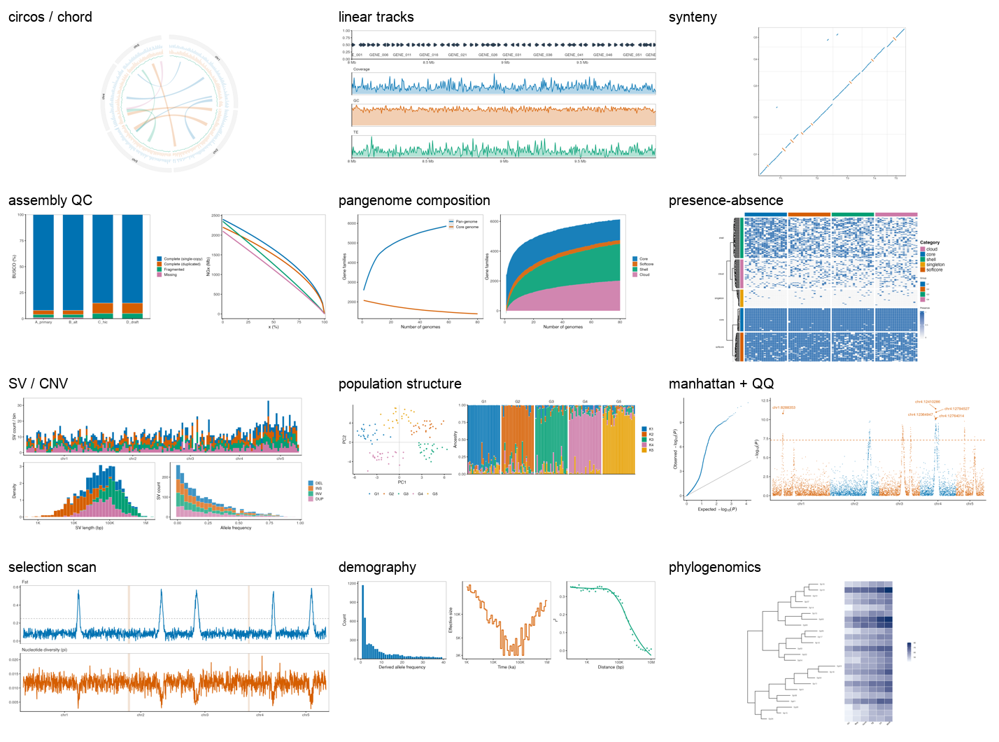
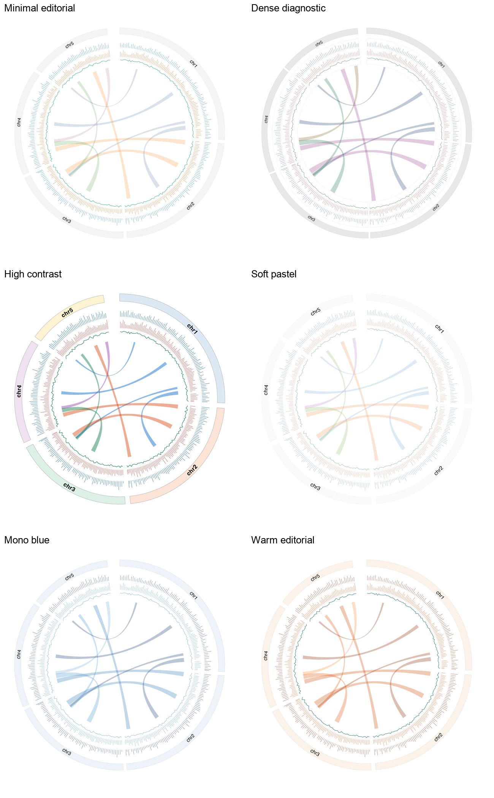

# nature-genome-plot

**把基因组、泛基因组、群体基因组的结果，变成能投 Nature 系的图。**


13 个图型模板、42 个风格预设、42 张带文献出处的风格卡，模板全部是可运行的 R 代码。
数据规整时直接出图；不规整时，先理顺格式。

> **30 秒版**：把数据丢过来 → 判图型 → 诊断列名/缺失/命名 → 映射成契约表 → 渲染两种风格 → 按 12 项投稿标准检查。
> 图和代码都可以直接改（MIT 许可）。



---

## 为什么会有这个 skill

基因组文章的图，卡人的通常是三件事：

1. **选错图**。5 条染色体画 circos 很漂亮，40 条 contig 画 circos 就是一团毛线。
2. **过不了美术编辑**。Nature 主图 183 mm、5–7 pt、矢量、字体可编辑、色盲友好，每一条都能让图退回重做。
3. **数据对不上模板**。测序公司给的列名、混用的 `chr1`/`1`、`p=0`、VCF/GFF/PAF，没人愿意每次重写清洗脚本。

这些环节被拆成了可复用的资产：图型契约、风格卡、适配器、检查清单。

---

## 这是什么

一个遵循 **Agent Skills** 标准的绘图 skill：DSH、Claude Code、Codex 都能装，也可以脱离 agent 单独当 R 脚本库用。

它做三件事：

1. **选型**：看你的数据长什么样，告诉你该画 circos 还是 Manhattan
2. **出图**：套模板，同一份数据换 YAML 就能出 3–6 种风格
3. **救数据**：列名不对、染色体命名乱、p 值是 0、格式是 VCF/GFF/PAF；先诊断再映射，最后才渲染

知识库来自 2023–2026 年 **Nature、Nature Genetics、Nature Plants、Nature Ecology & Evolution、
Nature Microbiology、Nature Communications** 的 200 篇开放获取论文（1672 张图），
每条风格结论都能回指 DOI + 图号。

## 适合谁

- 手上已有统计结果（PCA、GWAS、Fst、组装指标、泛基因组矩阵），卡在「怎么画才像 Nature」
- 要投 Nature 系，不确定尺寸、字号、配色、格式会不会被 art editor 打回
- 组里没人会 R 的 ggplot/circlize，但图必须自己出

## 不适合谁

- 想让它替你跑 GWAS、PCA、组装：它只消费结果，不做统计
- 想 1:1 复刻某篇论文的图：版权与许可不允许，只做同范式重写
- 想要示意图/模式图：那是 Illustrator 的活

---

## 能做什么

| 场景 | 你会得到 |
|---|---|
| 「我有数据，不知道画什么」 | 判型 + 2 个风格对比 + 可运行代码 |
| 「照这篇论文的感觉来」 | 最接近的风格卡 + 同范式实现（不做像素复刻） |
| 「已经有图，编辑说字号不对」 | 12 项合规检查 + 修复后的图 |
| 「数据是测序公司给的，列名很怪」 | 诊断报告 + 映射方案 + 转换后的表 |
| 「投 Nature Communications，尺寸多少」 | 期刊硬规格 + 按规格出的矢量图 |

---

## 13 个模板

| # | 图型 | 回答什么问题 | 需要什么数据 | 风格 |
|---|---|---|---|---|
| 1 | `circos-landscape` | 染色体尺度的组成 + 区域之间的关系（弦图） | 染色体长度、轨道值、区间连线 | 6 |
| 2 | `linear-tracks` | 某个位点长什么样：基因、覆盖度、GC、重复 | GFF/BED + 轨道值 + 区间 | 3 |
| 3 | `synteny` | 两个组装之间谁和谁同源、哪里倒位 | 双物种坐标对 | 3 |
| 4 | `assembly-qc` | 组装完整吗、连续吗 | BUSCO + NGx | 3 |
| 5 | `pangenome-composition` | 泛基因组饱和了吗、核心收缩到多少 | 基因组数、pan/core 计数 | 3 |
| 6 | `presence-absence` | 哪些基因在哪些基因组里 | 基因×基因组 0/1 矩阵 | 3 |
| 7 | `sv-cnv` | 结构变异有多少、多长、频率如何 | SV 表（类型/长度/频率） | 3 |
| 8 | `population-structure` | 谁和谁像、混了多少 | PCA 坐标 + ADMIXTURE 比例 | 3 |
| 9 | `manhattan-qq` | 信号在哪、整体膨胀没有 | GWAS 汇总统计 | 3 |
| 10 | `selection-scan` | Fst 峰 / π 谷在哪 | 窗口统计 | 3 |
| 11 | `demography` | 群体大小怎么变、重组多快 | SFS / PSMC / LD 衰减 | 3 |
| 12 | `phylogenomics` | 拓扑结构 + 性状怎么分布 | Newick 树 + 矩阵 | 3 |
| 13 | `binned-correlation` | 多样性沿分位与 TE/基因密度、甲基化怎么变 | 窗口表（diversity + 数值列） | 3 |

每个图型的输入契约、结构变体、硬规则在 `catalog/archetypes/<id>.yaml`。

## 42 种风格

三个风格族，跨图型保持视觉一致：

| 风格族 | 定位 | 适用 |
|---|---|---|
| `minimal-editorial` | 白底、细线、直接标注 | 主图、首图 |
| `dense-diagnostic` | 网格、高密度、信息优先 | 补充图、全基因组扫描 |
| `high-contrast` | 加粗、7–8 pt、强对比 | 汇报、预印本、投影 |

circos 另有 3 种：`soft-pastel`、`mono-blue`、`warm-editorial`。
`binned-correlation` 的 `nature-decile` 按一篇 Nature Communications 的 Fig. 2b–g 复刻：
十分位箱线 + 黄→橙→紫→蓝渐变 + rho/P 标注，适合多样性与 TE/基因密度、甲基化的相关。



每张风格卡带 `submission_safe` 和色差数值（deutan/protan）；`minimal-editorial` 与
`dense-diagnostic` 已过色盲检查，`soft-pastel`/`warm-editorial` 仅装饰用。

---

## 安装

### 依赖

- **R ≥ 4.4**：ggplot2、data.table、patchwork、yaml、circlize、ComplexHeatmap、ggtree、treeio、ggrepel、scales、ragg、svglite、colorspace
- **Python ≥ 3.9**：pandas、PyYAML、Pillow（只用于校验与目录脚本）
- 字体：默认 **Arial**；PDF 设备不支持 Arial 时回落 Helvetica，需要 Arial 的 PDF 请导出 SVG

### 装到 agent 里

```bash
git clone https://github.com/nongxinshengxin/nature-genome-plot.git
cd nature-genome-plot

./install.sh            # DSH + Claude Code + Codex，用户级
./install.sh claude     # 只装一个：dsh | claude | codex
./install.sh project    # 装到当前项目的 .claude/skills 与 .agents/skills
```

脚本只是建软链，不改任何配置。三个 agent 读的是同一份 `SKILL.md`（Agent Skills 标准），
区别只在目录：

| Agent | 用户级目录 | 项目级目录 | 查看/调用 |
|---|---|---|---|
| DSH | `~/.dsh/skills` | — | 重开会话 |
| Claude Code | `~/.claude/skills` | `.claude/skills` | `/skills`，或 `/nature-genome-plot` |
| Codex | `~/.agents/skills` | `.agents/skills` | `/skills`，输入 `$` 选择 |

> 旧版 Codex 也可能读 `~/.codex/skills`；若 `/skills` 里看不到，把软链再放到那里。

### 装依赖

```bash
Rscript scripts/doctor.R                # 先体检：R/包/字体/Python 一次报全
Rscript scripts/doctor.R --install      # 缺什么装什么（会先告诉你要装哪些）
Rscript scripts/install_deps.R          # 只装 R 依赖；--check 只看
pip install pandas pyyaml pillow
```

**不会装也没关系**：把报错贴给 agent，说「帮我装依赖」。skill 会跑 `doctor.R`，
用大白话说清楚缺什么、装什么、要不要管理员权限，经你同意后再装，装完重跑验证。

R 依赖分两类：

- CRAN：ggplot2、data.table、patchwork、yaml、circlize、ggrepel、scales、ragg、svglite、colorspace
- Bioconductor：ComplexHeatmap、ggtree、treeio（脚本会用 BiocManager 装）

> 模板也会自动识别项目内的 `.Rlib`（旧环境兼容用）；正常装到用户库即可。

### 验证

```bash
python3 scripts/validate/catalog_check.py     # 结构完整性
python3 scripts/validate/smoke.py             # 42 个渲染组合
Rscript scripts/validate/style_audit.R        # 色盲审计
```

---

## 快速开始

### 1. 直接跑模板

```bash
Rscript templates/R/population-structure.R \
  --data fixtures/population-structure \
  --style minimal-editorial \
  --out out/pop.png --width 183 --height 62 --dpi 300
```

### 2. 出两种风格给老板挑

```bash
for s in minimal-editorial high-contrast; do
  Rscript templates/R/manhattan-qq.R --data fixtures/manhattan-qq \
    --style $s --out out/manhattan-$s.png --width 183 --height 70
done
```

### 3. 在 agent 里说人话

> 我有一份 GWAS 汇总统计，想投 Nature Genetics，要主图。

skill 会：判型 → 诊断数据 → 选 2 个风格 → 渲染 → 12 项检查 → 给你 PDF/SVG + 代码 + spec。

### 4. 脏数据

```bash
python3 scripts/profile/infer_archetype.py --data messy.csv   # 猜图型
Rscript scripts/profile/profile_data.R --data messy.csv --out profile.md
Rscript scripts/profile/map_data.R --data messy.csv --map map.yaml --out clean.tsv
```

`map.yaml` 长这样：

```yaml
rename: {CHR: chromosome, BP: position, P: p_value}
drop: [note, beta]
chr_prefix: add
drop_na: [P]
```

完整案例见 [examples/walkthrough-gwas.md](examples/walkthrough-gwas.md)。

---

## 五个工作流

| 工作流 | 触发 | 产物 |
|---|---|---|
| `new-figure` | 有数据，要出图 | 图 + 代码 + spec |
| `adapt-data` | 数据格式不规范 | 映射后的表 + 诊断 |
| `restyle` | 已有图/脚本要换风格 | 新图 + diff 说明 |
| `audit` | 只做合规检查 | 12 项报告 |
| `browse` | 不知道能画什么 | 图型清单 + 建议 |

## 数据不统一怎么办

真实数据大多不规整。按四层处理：

1. **判型**：`infer_archetype.py` 按列名和形状匹配 12 个契约，列出缺哪列
2. **诊断**：`profile_data.R` 报缺失、命名混用、p=0、重复键
3. **映射**：`map_data.R` 按 YAML 改名/加常量/丢列/增删 chr 前缀
4. **适配器**：VCF、GFF、PAF、PLINK eigenvec、bedGraph/bigWig 直接转契约表

`adapters/` 里没有的格式，给等价命令，不静默降级。

---

## 目录结构

```
├── SKILL.md                  # 路由：意图 → 工作流 → 按需加载
├── manifest.yaml             # 加载轴
├── catalog/
│   ├── index.yaml            # 13 行摘要
│   ├── archetypes/           # 输入契约、规则
│   └── styles/               # 39 张风格卡（证据 + CVD + 适用场景）
├── templates/
│   ├── R/                    # 13 个 CLI 模板
│   └── presets/              # 42 个 YAML
├── adapters/                 # 5 个格式转换
├── scripts/
│   ├── profile/              # 判型、诊断、映射
│   ├── harvest/              # 文献语料构建
│   └── validate/             # 冒烟、catalog、CVD
├── fixtures/                 # 13 套合成数据
├── references/               # 期刊规格、选型规则、工作流
├── examples/                 # 端到端案例
└── docs/                     # 验收、审计、已知问题
```

---

## 质量

| 检查 | 结果 |
|---|---|
| 渲染矩阵 | 42/42 通过 |
| catalog 结构 | 12 图型 / 39 卡，0 错误 |
| 色盲审计 | 25 通过，9 个幻灯片专用，2 个装饰风格标注 |
| 适配器 | 5/5 通过 |

细节见 [docs/acceptance.md](docs/acceptance.md)、[docs/style-audit.md](docs/style-audit.md)。

## 已知限制

- 风格卡是 `draft`：证据到「DOI + 图号 + 图注」级别，未逐张对原图做像素级核验
- PDF 设备不支持 Arial，导出 PDF 会回落 Type1 Helvetica 且字体未嵌入；需要 Arial 或可嵌入字体时请导出 SVG
- 除 1 份脏 GWAS 外，其他图型还没在真实数据上跑过
- 语料 200 篇中 Nature Communications 占 90，风格归纳偏这个刊

## 路线图

- [ ] 用论文原图做像素级风格核验
- [ ] PLINK bed / bigWig 原生解析
- [ ] 多面板拼版（Figure 1 级组合）
- [ ] 真实数据案例 3 例（植物泛基因组、微生物群体、人类 GWAS）
- [ ] 图注草稿生成

## 扩展

看到新的 Nature 图型或风格？这个项目留了接口：

```bash
python3 scripts/extend/status.py                      # 新会话先看状态
python3 scripts/extend/new_style.py <archetype> <id>  # 加风格
python3 scripts/extend/new_archetype.py <id>          # 加图型
```

协议写在 [docs/EXTENDING.md](docs/EXTENDING.md)：给图或 DOI、判断是图型还是风格、
生成骨架、填契约/证据、跑校验。所有状态在文件里，新会话不需要上一轮上下文。

## 数据来源与版权

- 语料：Europe PMC 开放获取全文，仅保存结构与出处，**不保存论文图片**
- 风格表述用 `inspired by` / `observed in`，不写 `reproduced from`
- 不收录第三方仓库代码；模板全部自研
- 用户数据本地处理，不上传

## License

MIT，见 [LICENSE](LICENSE)。
